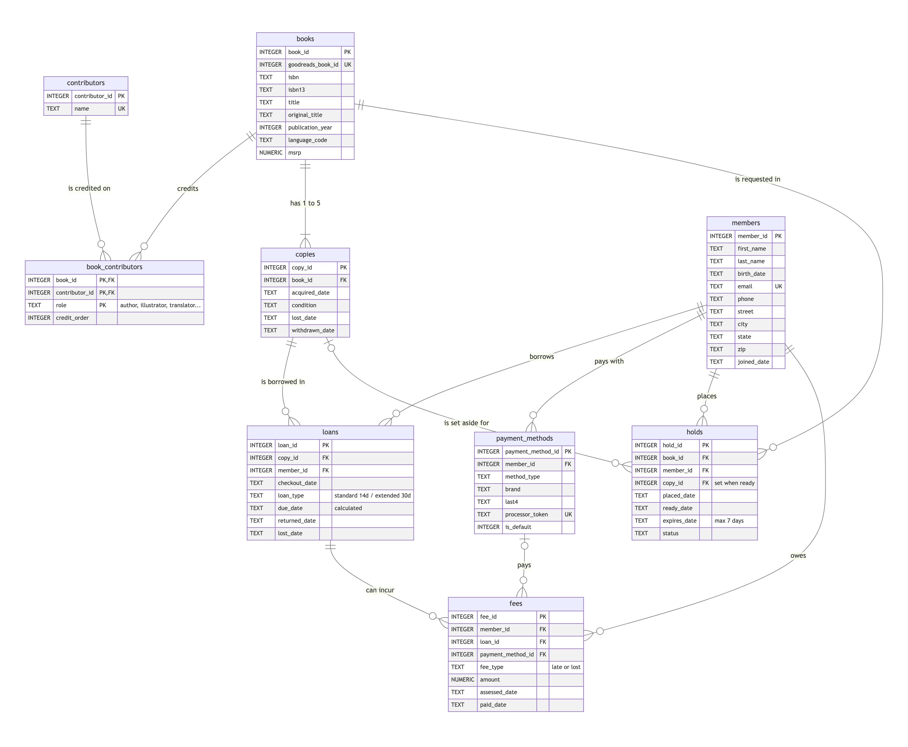
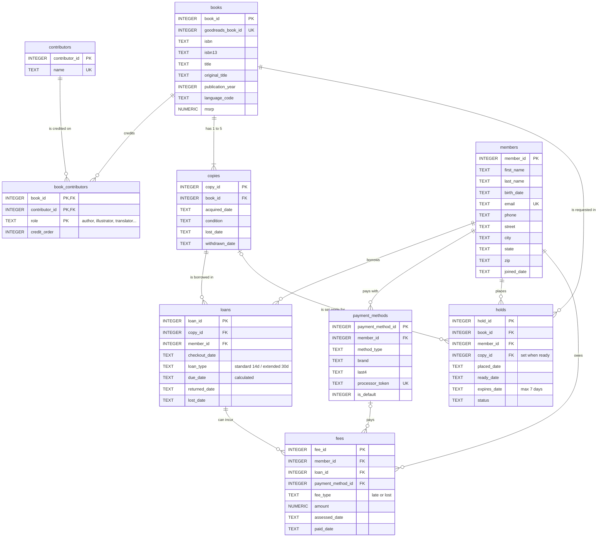

Mermaid source for the ERD

# My Neighborhood Library: Design Summary

**Jeremy Insell · MSAI-5523 · Module 2**

My library is a small neighborhood library. It needs to know which books and copies it owns (up to 5 per title), who its members are (age group, birthday for a free-book email, address, a way to pay), and who has what. Loans are 14 days, or 30 if chosen at checkout, with at most 5 out per member. I also wanted to know how often each book goes out, how long it sits on the shelf, and how long it stays checked out.

## What each table is and why it exists

- **books**: one row per title (25 loaded from Goodbooks-10k), plus the MSRP so the library knows what to charge for a lost copy.
- **contributors**: one row per person, so J.K. Rowling exists once no matter how many of her books we own.
- **book_contributors**: links books to people *and records their role* (author, illustrator, translator, editor, introduction, afterword, narrator).
- **copies**: one row per physical book on the shelf. A title is not something you can hand someone; a copy is.
- **members**: who can borrow, including birth date and address. Age group is calculated from the birth date, so a child moves into the next group automatically.
- **payment_methods**: how a member pays fees. Only the brand, last 4 digits and a processor token are stored, never a full card number.
- **loans**: one checkout of one copy by one member, with the due date and the return or loss date.
- **holds**: a member's request for a title. Once a copy comes back, it is set aside for them for up to 7 days.
- **fees**: late fees and lost-book fees, each tied to the loan that caused it and marked when paid.

## Relationships

**One-to-many:** A book has many copies; a copy has many loans over its life; a member has many loans, holds, payment methods and fees; a loan can produce fees. Each of these is tracked with a **foreign key** on the "many" side. For example, `loans.copy_id` points to exactly one copy and `loans.member_id` to exactly one member.

**Many-to-many:** Books and contributors. *Harry Potter and the Prisoner of Azkaban* has three people on it, and Mary GrandPré is on more than one Harry Potter book. A many-to-many relationship can't fit in one column. That is exactly what was wrong with the `authors` column in books.csv, which crammed "J.K. Rowling, Mary GrandPré, Rufus Beck" into one cell. So the **book_contributors** junction table holds one row per book-person-role pairing. Members and copies are also many-to-many over time, and **loans** is the table in between that records each pairing with its dates.

## A design decision: the database enforces the fees

I didn't want fees to depend on someone doing math at the front desk. When a late book is returned, a trigger charges the fee automatically: $0.25 a day for days 1–7, $0.50 for days 8–14, $1.00 a day after that, capped at $75. When a book is reported lost, a trigger marks the copy lost and charges that book's MSRP. The due date works the same way: it is calculated from the loan type, and the loan type can't be changed after checkout. That matches my rule that an extended loan has to be chosen up front. In the sample data the database charged 70 late fees across 603 loans, plus one lost copy of *The Lion, the Witch and the Wardrobe* at $8.99. A test return 42 days late came out to $33.25, which matches the rates when worked by hand.

## One thing I changed

I asked for three children's age groups (under 8, 8–12 and 13–18), but I also asked Claude to make the members 25 past and present Titans players. They are all adults, so none of the child categories show up in the data. Claude built the age-group logic but never noticed it went untested. I had it add test members aged 6, 10, 15 and 18 to a throwaway copy of the database, and they landed in the correct groups. The real database still has only adults, which is something I'd fix before opening the doors.

*Also:* books.csv stores isbn13 in scientific notation, which drops the last digit, and isbn has lost its leading zeros. That is the Week 1 zip-code problem again, so ISBNs are stored as text and each ISBN-13 was rebuilt from its ISBN-10.
